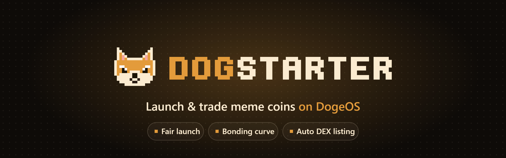

  

  <a href="https://dogstarter.dog"><b>Launch app</b></a> ·
  <a href="https://swap.dogstarter.dog"><b>DogSwap DEX</b></a> ·
  <a href="https://t.me/dogstarter">Telegram channel</a> ·
  <a href="https://t.me/dogstarter_dog">Community</a> ·
  <a href="https://x.com/dogstarterhq">X</a> ·
  <a href="mailto:contact@dogstarter.dog">Contact</a>

## Hi, we're Dogstarter 🐕

Dogstarter is a meme coin launchpad on **DogeOS**, the EVM app layer for Dogecoin.
Anyone can launch a token in seconds, trade it on a fair bonding curve, and watch it
graduate to the DEX automatically when the curve fills.

**Live on DogeOS testnet now.** Mainnet follows the DogeOS mainnet launch.

## What you can do

| | |
| --- | --- |
| 🚀 **Launch** | Create a meme coin in four steps. No code, no presale. |
| 📈 **Trade** | Buy and sell on the bonding curve from the first block, with anti-snipe protection. |
| 🎓 **Graduate** | When the curve fills, the token and its liquidity move to DogSwap automatically. |
| 🔁 **Swap** | DogSwap DEX with multi-hop routing, limit orders and LP locks. |
| 📺 **DogLive** | Creators go live next to their token chart. |
| 🔐 **Sign in your way** | MyDoge, MetaMask, WalletConnect, or email / Google / X through the DogeOS SDK. |

## Security

- All testnet contracts are verified on Sourcify and the DogeOS explorer.
- Every wallet transaction shows a clear confirm screen with exact-amount approvals.
- Contracts v1.0 are checked with automated security scans (FYEO Scanner), unit and fuzz tests, and static analysis. A professional manual audit is planned.
- Admin changes go through an on-chain timelock (Control contract below); on mainnet the owner is a Safe multisig.

Found a bug? Email **contact@dogstarter.dog**. Please report privately first.

## Testnet contracts v1.0 (DogeOS testnet, chain 6281971)

| Contract | Address |
| --- | --- |
| Launchpad factory | `0x7E6D018a10e0aA82912c8177d014e807B9a13C0D` |
| Control (timelock) | `0x9bc2861DD95ad8cC70D3e188E8574101d5A5016E` |
| Fee ledger | `0x3C0D230a78C3878E6aB736b36556818701C8Ee4E` |
| Holder rewards | `0xe0FD4aA1a0334Af2A04212A2F3e3D7Dd727E0763` |
| Payments (Boost) | `0xe659a33250f885CA7715eC2568e23eCd35e9bCb9` |
| DogSwap factory (graduated pools) | `0xBfD1E06b4cec6d768f31bcD9a0ea0e1B34e63845` |
| DogSwap router (graduated pools) | `0xf7B76092428012dDEE43DCEc38060545f7208734` |
| DogSwap OpenFactory | `0x59980f09C56C33B250CfFDaD53307EA12244b978` |
| DogSwap OpenRouter | `0xd25F673f275Ca33B8E9bc27c2ABC4554a94F7096` |
| Aggregator | `0x457af02E264EcE2345B79e8547BB16d31b114655` |
| LP Locker | `0xAb6036A79488045a46015D8d36D198E1880710e5` |
| Orders | `0x3A1b54F4EdF400EA94Dc6ad4FA34e79647baC741` |

Such launch. Very fair. Wow. 🐾

