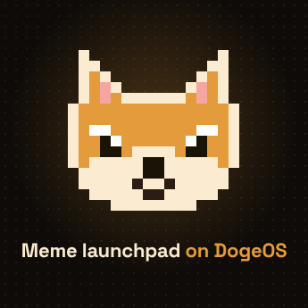
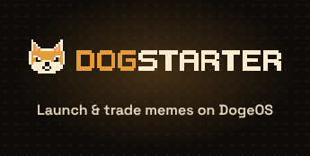
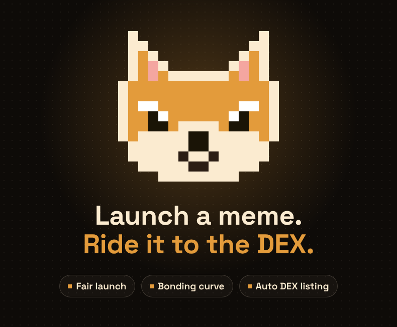
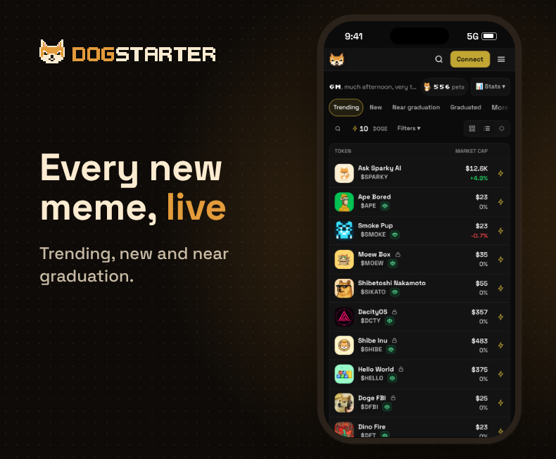
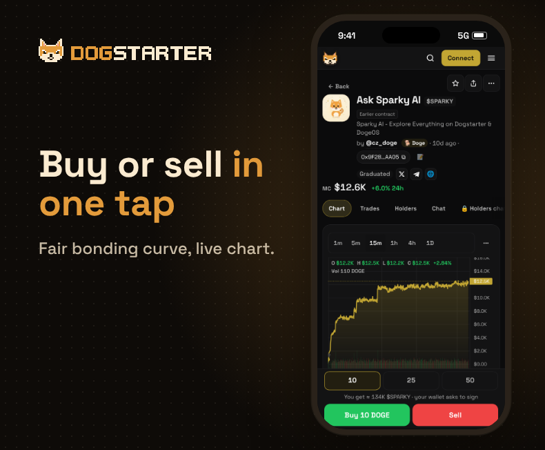
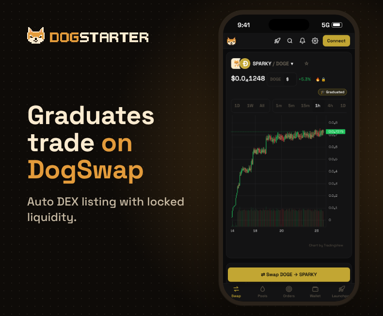

# Dogstarter: MyDoge Wallet listing assets

Official listing assets for **Dogstarter** (PNG, exact sizes).

**Download all at once:** [Dogstarter-MyDoge-listing-assets.zip](https://github.com/dogstarter/dogstarter/raw/main/mydoge-listing/Dogstarter-MyDoge-listing-assets.zip) (8 PNG files, no other file types)

## Listing info

- **Project title:** Dogstarter
- **Short description:** Meme coin launchpad
- **Longer description:** Launch and trade meme coins on DogeOS: fair bonding curves, automatic DEX listing, locked liquidity, and fees shared with creators.
- **Dapp link:** https://dogstarter.dog
- **X link:** https://x.com/dogstarterhq

## Logo (125x125)

## Project image (345x345)

## Banner (345x174)

## Carousel (790x652, in display order)

| 1 | 2 | 3 |
| --- | --- | --- |
|  |  |  |

| 4 | 5 |
| --- | --- |
|  |  |

To download a single image: open it, then use the download button at the top right.
